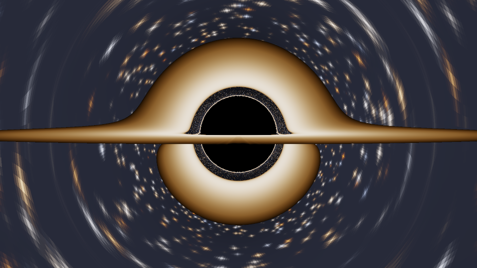
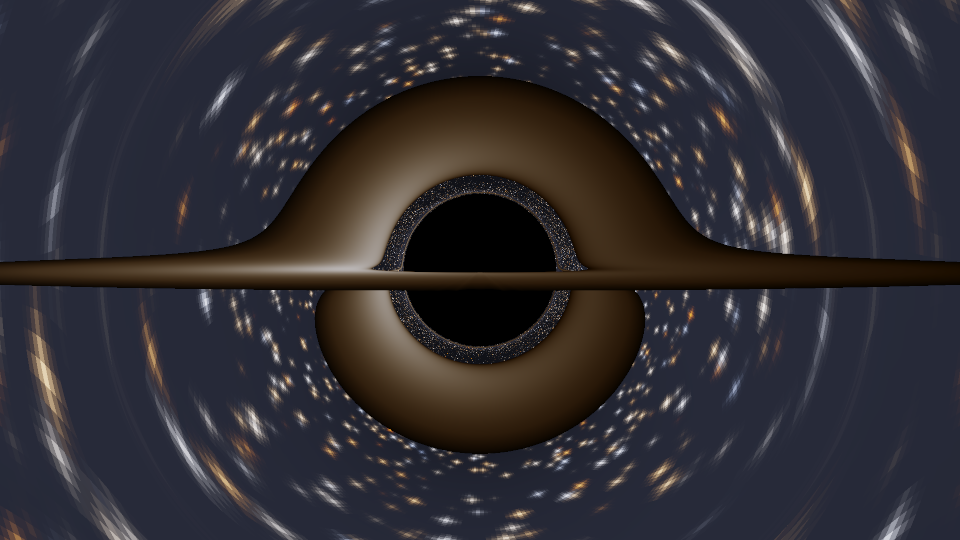

# Gargantua — running the equations behind *Interstellar*

Two pieces of general relativity drive the black hole in *Interstellar*, and
both are implemented here from scratch in Python (NumPy only — no image or
physics libraries).



## 1. The Kerr metric — where "1 hour = 7 years" comes from

Roy Kerr's 1963 solution for a **spinning** black hole, in Boyer–Lindquist
coordinates (G = c = 1):

```
ds² = -(1 - 2Mr/Σ) dt²  -  (4Mar sin²θ / Σ) dt dφ
      + (Σ/Δ) dr²  +  Σ dθ²
      + (r² + a² + 2Ma²r sin²θ / Σ) sin²θ dφ²

Σ = r² + a² cos²θ        Δ = r² - 2Mr + a²        a = J/M
```

The `dt dφ` cross term is **frame dragging**. It has no counterpart in the
non-spinning Schwarzschild solution, and it is the entire reason Miller's
planet is possible: as `a → M` the innermost stable circular orbit slides down
from `6M` to `M`, so a planet can sit close enough to the horizon for extreme
time dilation *and still be on a stable orbit*.

For a circular equatorial orbit:

```
dτ/dt = √(r³ - 3Mr² + 2a√M r^{3/2}) / (r^{3/2} + a√M)
```

Solving that for the film's 1 hour ↔ 7 years (a factor of 61,320) gives:

| quantity | value |
|---|---|
| spin parameter `a/M` | `0.99999999999998664594…` |
| spin deficit `1 - a/M` | `1.335 × 10⁻¹⁴` |
| orbit radius (= prograde ISCO) | `1.000037662175 M` |
| height above the horizon | `3.75 × 10⁻⁵ M` |
| orbital period, distant observer | `1.72 hours` |
| orbital period, on the planet | `0.10 seconds` |

Kip Thorne quotes a spin deficit of *about* `1.3 × 10⁻¹⁴` in *The Science of
Interstellar*, and an orbital period of ~1.7 hours — both reproduced here.
Gargantua has to be spinning within one part in 100 trillion of the maximum
allowed by general relativity.

This calculation runs in `decimal` at 60 significant digits: in float64 the
subtraction `r³ - 3Mr²` loses every significant figure at these radii.

## 2. The null geodesic equation — the picture

Double Negative's renderer (DNGR) traced light rays through the Kerr metric,
one per pixel, to produce the images in the film. This repo does the same in
the Schwarzschild limit (`a = 0`), where the null geodesic reduces to a single
exact ODE for `u = 1/r` against the angle `φ` swept around the hole:

```
d²u/dφ² + u = 3Mu²
```

Drop the `3Mu²` and you get a straight line in polar coordinates. Keep it and
you get light bending, the photon sphere, the shadow, the Einstein ring, and
the disc that appears to arc over the top *and* under the bottom of the hole
simultaneously — because you are seeing its far side, lensed over and under.

```
event horizon              r = 2M
photon sphere              r = 3M
shadow / critical impact   b = 3√3 M ≈ 5.196 M
```

The shadow is larger than the horizon because the hole bends light from behind
itself into your eye.

## 3. Colour

The disc is a Novikov–Thorne thin disc, `T(r) ∝ [(1 - √(r_in/r))/r³]^{1/4}`.
Temperatures become pixels by integrating Planck's law against the CIE 1931
colour matching functions (analytic fits from Wyman, Sloan & Shirley 2013) and
converting through sRGB primaries — not a colour ramp.

## Doppler shift and beaming

Double Negative computed these and then **switched them off** for the film:
the real asymmetry is so extreme it reads as a rendering error on screen.

Here the emitter is a circular geodesic, so the observed/emitted frequency
ratio is `g = 1 / [u^t (1 - Ω b_z)]`, brightness scales as `g⁴` (Liouville's
theorem), and a blackbody stays a blackbody at temperature `gT`. Across the
inner disc `g` runs from **0.48 to 1.41** — a **75× brightness ratio** between
the receding and approaching sides.

```
python3 gargantua_run.py --doppler --disk-gain 0.3 -o gargantua_doppler.png
```



The left side is the approaching side.

## Running it

```bash
python3 -m pip install numpy
python3 gargantua_run.py                 # physics write-up + gargantua.png
python3 gargantua_run.py --no-image      # just the numbers
python3 gargantua_run.py --help          # camera, disc and exposure options
```

A 960×540 frame at 2× supersampling traces ~2.1 million rays in about a
minute.

## Validation

`python3 -m tests.test_physics` checks both solvers against closed-form
results:

- ISCO → `6M` at `a = 0`, → `M` (prograde) and `9M` (retrograde) as `a → M`
- Kerr time dilation reduces to `√(1 - 3M/r)` at `a = 0`
- the solved spin reproduces the 61,320 dilation factor
- **capture threshold lands on `b = 3√3 M` to 1 part in 10⁶**
- **deflection matches the post-Newtonian series
  `4M/b + (15π/4)(M/b)² + (128/3)(M/b)³` to ~1 part in 10⁷**, with the
  residual scaling as `(M/b)⁴` exactly as the next order predicts

The leading term of that series is Einstein's 1915 prediction — 1.75 arcsec at
the solar limb, the number Eddington sailed to Príncipe to measure in 1919.

## Caveats

The **numbers** are Kerr. The **image** is Schwarzschild: rendering a
near-extremal Kerr hole needs the full Carter-constant geodesic system, which
is a much larger job than the one-line ODE above. So the picture shows an
undragged hole with a symmetric shadow, where a real render of Gargantua at
`a/M ≈ 1` would show the shadow flattened on one side by frame dragging.

The disc geometry is a razor-thin opaque plane with no vertical extent, no
turbulence, and no self-shadowing.
